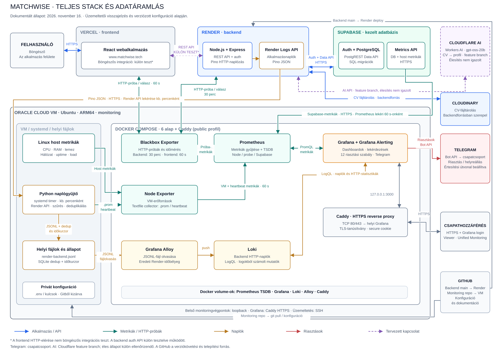

# MatchWise stack and data flow

[Magyar változat](README.md) · [Documentation index](../README.md)

The diagram shows the project's documented architecture as of November 10, 2026. Boxes inside providers and the VM indicate deployment locations; dashed purple elements are planned integrations. This English guide accompanies the original Hungarian-labelled diagram, which is preserved below.

- [Editable draw.io / diagrams.net file](matchwise-stack.drawio)
- [Zoomable SVG](matchwise-stack.svg)

## Editing

In diagrams.net, select **File → Open From → Device** and open `matchwise-stack.drawio`. Boxes, groups, arrows and labels are individually editable. The Docker group is nested in the Oracle VM group. The diagram occupies one page.

`build_stack_diagram.py` uses the Python standard library to generate draw.io and SVG from shared geometry. Running it again overwrites manual edits to the generated files.

## Connections and notation

| Notation | Meaning |
|---|---|
| Blue | Application HTTPS / API connection |
| Teal | Metrics and automatic HTTP probes |
| Gold/brown | Application logs, JSONL and Loki |
| Red | Grafana alert notifications |
| Grey | Operator access and version-control/deployment relationship |
| Dashed purple | Planned connection or service |
| Double-headed arrow | Labelled request/response or query/result relationship |

A data-flow arrow does not always identify the network connection initiator. Prometheus pulls exporter/Supabase metrics; the Python collector pulls Render Logs API events. Grafana queries Prometheus and Loki. Labels explicitly identify these pull relationships.

## What runs where?

- **Vercel:** React frontend, currently `https://www.matchwise.tech/`.
- **Render:** Node.js/Express backend deployed from the team's `job-portal-backend` repository, with Pino HTTP logging. Render exposes stdout application logs through its Logs API.
- **Supabase:** managed PostgreSQL, Supabase Auth, PostgREST Data API and the project's Metrics API endpoint. These are service functions; the diagram does not claim a separately operated container for each one.
- **Oracle VM / Docker Compose:** Prometheus, Grafana with built-in Alerting, Node Exporter, Blackbox Exporter, Loki and Grafana Alloy. Containers use host networking; monitoring web endpoints bind to loopback.
- **Oracle VM / systemd:** Python Render log collector. The timer starts another run approximately one minute after completion (`OnUnitInactiveSec=1min`, `AccuracySec=10s`).
- **Oracle VM / files:** deduplicated JSONL, private SQLite state and time cursor, textfile metrics and private configuration. Secrets are excluded from Git.
- **Docker volumes:** persistent data for Prometheus, Grafana, Loki and Alloy.
- **Telegram:** notification destination configured in the Grafana contact point, using the Bot API.
- **GitHub:** backend source for Render, and version history for monitoring configuration/documentation. The VM is updated using the documented git pull process. The diagram does not claim automatic VM deployment or verified Render auto-deploy settings.

## Working paths and planned elements

1. The backend uses Supabase Auth and the Data API. Direct backend registration, login, account access, logout and post-logout rejection tests succeeded on November 9, 2026.
2. A November 9 inspection of the published frontend code found simulated login and registration. The frontend → backend connection is therefore marked planned. This is a dated observation, not a current live integration test.
3. The AI provider and assistant integration details have not been selected. Backend → AI is a proposed future path, not a verified running service.
4. The original diagram records the earlier configuration of nine rules. **Later November 10 update:** 12 outage/monitoring-failure rules were provisioned, and the operator supplied a successful collector Firing/Resolved test. This does not prove delivery for every rule; see the [current alerting plan](../alerting-plan.en.md). The original diagram remains a historical snapshot.

## Main flows

- **Resource metrics:** Linux → Node Exporter → Prometheus → Grafana.
- **External HTTP probes:** Blackbox → backend `/api/health` every 30 minutes; Blackbox → frontend every 60 seconds. Prometheus collects probe metrics.
- **Supabase metrics:** Metrics API → Prometheus every 60 seconds with private authentication.
- **Backend logs:** Pino → Render Logs API → Python collector → JSONL → Alloy → Loki → Grafana. Alloy preserves the original Render timestamp.
- **Collector heartbeat:** collector → .prom → Node Exporter textfile collector → Prometheus → Grafana.
- **Alerting:** Grafana Alerting → Telegram Bot API → configured chat.
- **Operator interface:** browser → SSH tunnel → Grafana.

Infrequent backend probes do not guarantee continuous availability. Successful API collection and log arrival in Loki are different states; the dashboard provides separate indicators for them. The later local Loki/Alloy health probes are documented in the alerting plan and are not separate edges in the historical diagram.

## Sources and verification

The original diagram was based on the README, Alloy configuration and collector/timer read at repository commit `a39e5a5f86ca7de2c64d3afb57d4b3ebd1ddefe2`, local Compose/Prometheus configurations, the November 9 backend source snapshot and the user's working-dashboard evidence. Its date identifies a documentation snapshot, not a full infrastructure audit.

The generator checks XML parsing, unique IDs, placement inside parent groups and orthogonal arrow segments. A PNG preview rendered from the SVG was visually checked. The draw.io file was not tested in the native diagrams.net editor. This English text does not add new diagram-validation claims.
