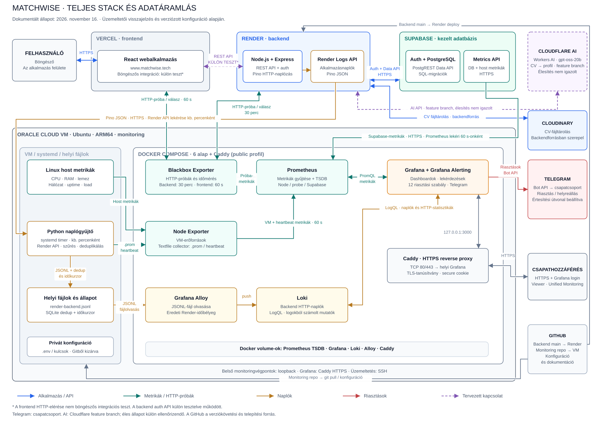

# MatchWise stack és adatáramlás

**Ábraverzió:** az alábbi draw.io/SVG a korábbi, 12 szabályos állapotot ábrázolja. November 18-án külön Render Metrics API → Python → .prom → Node Exporter adatfolyam, összehasonlító dashboard és három új szabály került a rendszerbe; az aktuális állandó szabályszám 15. Az ábrát ebben a dokumentációs frissítésben nem rajzoltuk újra. Aktuális részletek: [megvalósítási állapot](../SERVICE_COMPARISON_PLAN.md).

[English version](README.en.md) · [Dokumentációjegyzék](../README.md)

A szerkeszthető ábra a jelenlegi monitoringkonfigurációt és az üzemeltető által visszaigazolt telepítést mutatja. Az AI-integráció és a frontend–backend böngészős működés külön jelölést kap, ahol nincs igazolt telepítés vagy teljes integrációs teszt.

- [Szerkeszthető draw.io-fájl](matchwise-stack.drawio)
- [Nagyítható SVG](matchwise-stack.svg)

## Komponensek és elhelyezés

- **Vercel:** React frontend a https://www.matchwise.tech/ címen.
- **Render:** a csapat Node.js/Express backendje, a Pino stdout naplókat a Render Logs API szolgáltatja. A main automatikus telepítését az üzemeltető jelezte; a pontos éles commit külön ellenőrizendő.
- **Supabase:** kezelt PostgreSQL, Auth, PostgREST és Metrics API.
- **Cloudinary:** CV-fájltároló a november 15-i backendforrásokban; fiókbeállítása külön alkalmazásoldali konfiguráció.
- **Cloudflare Workers AI:** gpt-oss-20b profilkinyerés az átadott feature branchben; a változók Renderen előkészítve, a merge és a telepítés nem igazolt.
- **Oracle Docker Compose:** hat alap monitoring szolgáltatás (Prometheus, Grafana, Node Exporter, Blackbox Exporter, Loki, Alloy), valamint Caddy a public profilban.
- **Oracle systemd/fájlok:** collector és rotációs timerek; deduplikált JSONL, privát SQLite/kurzor, heartbeat textfile és Gitből kizárt titkok.
- **Tartós volume-ok:** Prometheus, Grafana, Loki, Alloy és a Caddy tanúsítvány-/működési állapota.
- **Telegram:** angol értesítések a csapat csoportjába, privát környezeti beállítással.
- **GitHub:** forrás és verziókövetés; a monitoringváltozások git pull és szolgáltatásonkénti alkalmazás útján jutnak az Oracle gépre.

## A fő adatfolyamok

1. Linux → Node Exporter → Prometheus → Grafana.
2. Blackbox → backend /api/health 30 percenként, frontend és helyi Loki/Alloy health 60 másodpercenként; az eredményt a Prometheus tárolja.
3. Supabase Metrics API → Prometheus 60 másodpercenként.
4. Pino → Render Logs API → Python collector → JSONL → Alloy → Loki → Grafana.
5. Collector-siker → heartbeat textfile → Node Exporter → Prometheus → Grafana Alerting.
6. Grafana Alerting → Telegram Bot API → csapatcsoport; 12 szabály, külön igazolt collector- és Node Exporter-teszttel.
7. Csapattag böngészője → HTTPS Caddy → helyi Grafana-bejelentkezés és Viewer-jogok; SSH-hozzáférést nem kap.
8. Feature-branch CV-folyamat: backend → Cloudinary-letöltés → szövegkinyerés → Cloudflare AI → Supabase profilmentés; az éles állapot még nem igazolt.

## Hozzáférés és értelmezés

Webes hozzáféréshez csak a Caddy TCP 80/443 publikált. A Grafana 3000-es és a belső monitoringvégpontok loopbacken maradnak; a Caddy admin API 127.0.0.1:2019. A felhasználók és ACL-ek a Grafana adatbázisában tárolódnak, nem a dashboard-JSON-ban. A Viewer dashboardláthatósága nem adatforrás-szintű elkülönítés.

Kék: alkalmazás-API; zöldeskék: metrikák; arany: naplók; piros: értesítés; szürke: hozzáférés/verziózás; szaggatott lila: nem igazolt vagy jövőbeli integráció. A nyilak feliratozott adat- vagy kérés/válasz kapcsolatot jelölnek; a Prometheus és a collector kezdeményezi a lekéréseket. Az ábra már nem kilenc aktív szabályt vagy kizárólagos SSH-s Grafana-elérést ír le. A frontend integrációs jelölése ellenőrzési korlát, nem a jelenlegi auth szimulált működésének állítása.

A health-siker nem teljes üzleti teszt. Collector-siker, Loki-health és tényleges eseménykézbesítés külön állapot. A jelenlegi 15 szabály nem fedi le önállóan a teljes nyilvános Caddy/DNS/TLS útvonalat vagy a VM teljes kiesését. Részletek: [monitoringterv](../monitoring-plan.md), [tesztnapló](../monitoring-tests.md).

## Szerkesztés és ellenőrzés

A matchwise-stack.drawio fájl diagrams.netben a File → Open From → Device menüvel nyitható meg. A Python-standardkönyvtáras build_stack_diagram.py mind a szerkeszthető XML-t, mind az SVG-t előállítja; újrafuttatása felülírja a generált fájlok kézi módosításait.

A november 16-i frissítés megtartja az eredeti elrendezést, és pontosítja a szabályszámot, a Caddy/csapathozzáférést, a Telegram-célt és a feature branch függőségeit. A generátor XML-feldolgozást, egyedi ID-kat, csoporton belüli elhelyezést és merőleges útvonalakat ellenőriz; ez különbözik a natív diagrams.net-szerkesztési és élő telepítési teszttől.

Az újragenerált SVG-ből PNG-előnézet készült, amelyet a frissítéskor vizuálisan ellenőriztünk. Natív diagrams.net-szerkesztési és új élő infrastruktúra-audit nem történt.
